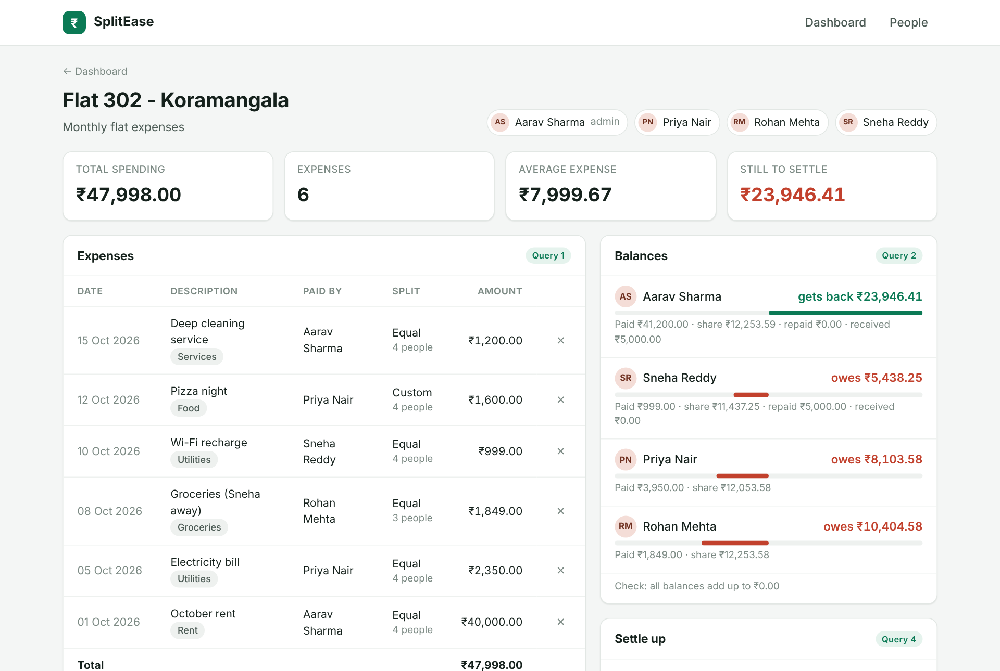
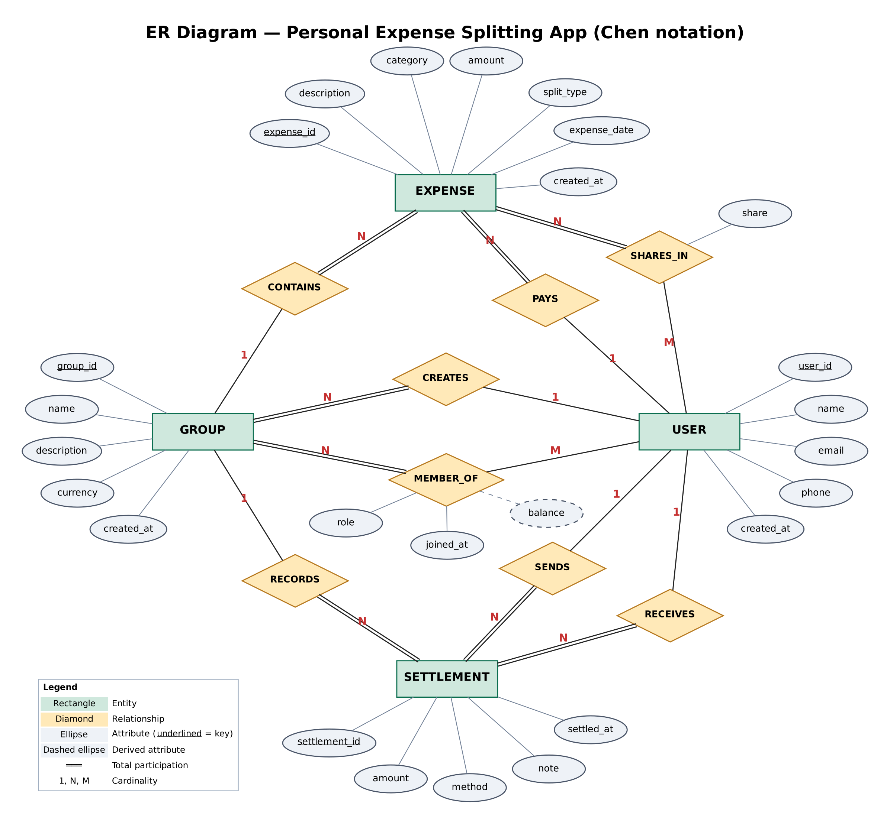

# SplitEase — Personal Expense Splitting App

A DBMS mini project. A **MongoDB** database for friends, flatmates and families who share expenses: it records who paid, splits costs equally or by custom amounts, works out who owes whom, and records the payments that settle debts. A **Next.js** website sits on top of the same database.



## What's in this repository

| Folder | Contents |
| --- | --- |
| [`database/`](database) | `expense_splitter.js`: the complete database (collections with `$jsonSchema` validation, 7 indexes, business-rule helpers, sample data, and the 4 required queries). `expense_splitter_output.txt` is the output of a full run. |
| [`expense-app/`](expense-app) | The SplitEase website (Next.js 16 + React 19 + MongoDB Node.js driver). |
| [`docs/`](docs) | `SplitEase_Complete_Project_Guide.pdf` (full beginner explanation, presentation script, viva Q&A), `Expense_Splitter_Project_Explained.pdf` (summary), ER diagrams, and screenshots. |

## Database design

5 entities are stored in **4 collections**:

| Collection | Holds | Embedded |
| --- | --- | --- |
| `users` | People using the app | — |
| `groups` | A flat, a trip, a family… | `members[]` (Group Member: userId, role, joinedAt) |
| `expenses` | Who paid, how much, for what | `participants[]` (Expense Participant: userId, share) |
| `settlements` | Payments that clear debts | — |

Balances are **derived, never stored**: `net = (paid + payments sent) − (own share + payments received)`. In every group the balances always add up to ₹0.00.



## The 4 required queries

| # | Query | How |
| --- | --- | --- |
| 1 | All expenses and total spending of a group | `$match` → `$lookup` → `$facet` (list, totals, by category) |
| 2 | How much each member owes or is owed | Expenses and settlements turned into ledger entries (`$unwind`, `$unionWith`), then `$group` per user |
| 3 | Expense history and contributions of a user | `$match` on `paidBy` / `participants.userId`, `$filter` for own share, `$facet` per group |
| 4 | Unsettled balances and recording settlements | Non-zero balances across groups; greedy "fewest payments" suggestion; validated insert into `settlements` |

## How to run (macOS)

First time:

```bash
brew tap mongodb/brew && brew trust mongodb/brew
brew install mongodb-community mongosh node
cd expense-app
npm install
```

Every time:

```bash
brew services start mongodb-community   # start MongoDB
cd expense-app
npm run seed                            # (optional) reset to sample data
npm run dev                             # start the website
```

Open **http://localhost:3000**.

To run only the database part: `mongosh database/expense_splitter.js`

## Tech stack

MongoDB 8 · mongosh · MongoDB Compass · Next.js 16 · React 19 · Node.js · MongoDB Node.js driver
